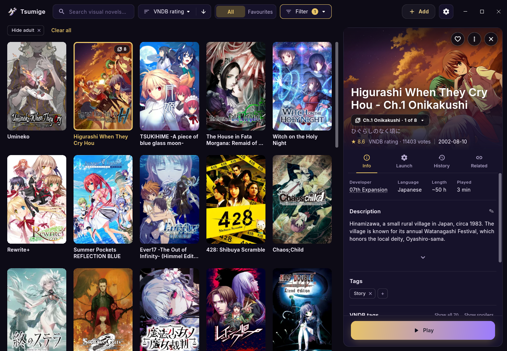

<p align="center">
 <picture>
  <source media="(prefers-color-scheme: dark)" srcset="app/assets/icon/tsumige_mark.png">
  <source media="(prefers-color-scheme: light)" srcset="app/assets/icon/tsumige_mark_on_light.png">
  
 </picture>
</p>

<h1 align="center">Tsumige</h1>

<div align="center">

[](https://github.com/aaronbamblett/tsumige/releases)
[](LICENSE)
[](https://github.com/aaronbamblett/tsumige/releases/latest)

</div>

<p align="center">A good-looking library and launcher for your visual novels</p>

<p align="center"></p>

> *Tsumige* (積みゲー) is the pile of games you've bought and haven't played yet. It's a sibling of [Tsumiru](https://tsumiru.app), the manga and webtoon reader, and shares its look and themes.

## What it is

Tsumige keeps your visual novels in one library with their cover art, descriptions and tags from [VNDB](https://vndb.org), and starts each one with the settings it needs. Everything stays on your computer: no account, no server, and your library is a JSON file in your data folder. Guides and the FAQ are at [tsumige.app](https://tsumige.app).

## Features

- **Cover art.** Covers and backgrounds come from VNDB. You can swap in another from the release packages or screenshots, or use your own image.
- **VNDB metadata.** Search VNDB when you add a game and the description, developer, release date, length, rating and tags fill in.
- **Folder import.** Point Tsumige at a folder of games. Each subfolder is matched to VNDB and its .exe is picked for you, and you check every match before anything is added.
- **Steam import.** Installed Steam games come in with their App IDs, matched to VNDB the same way folder imports are.
- **Episode groups.** Chapters and volumes of one game share a tile. Tsumige suggests groups and you review them before anything is grouped.
- **Edit details.** Set your own title, original title, developers and release date. Your edits are kept when VNDB data refreshes.
- **SteamGridDB art.** Covers and backgrounds from SteamGridDB with your own free API key. Art can be repositioned after you pick it.
- **Launching.** Proton (through umu-run), Wine, native executables and Steam. Prefix, Proton or Wine version and game locale are set per game, and installers or patches run inside the same prefix.
- **Playtime.** Every session is recorded from launch to exit, with a total and a history for each game.
- **Library tools.** Search, sort, favourites, your own tags and VNDB tags (spoilers hidden until you ask), related titles, and an adult filter.
- **Themes.** Built-in themes, light and dark, and a custom accent colour.

## Download

Get the latest build from [Releases](https://github.com/aaronbamblett/tsumige/releases/latest). The [download page](https://tsumige.app/download/) has install steps for each platform.

- **Linux:** the Flatpak from our own repo updates itself. An AppImage is also on Releases.
- **macOS and Windows:** builds are on Releases. Linux is the platform in daily use; macOS and Windows support is newer.

## Building

The Flutter version is pinned in `.fvmrc` and used through FVM. The app lives in `app/`.

```bash
cd app
fvm flutter pub get
fvm dart run build_runner build --delete-conflicting-outputs
fvm flutter build linux --release   # or: macos / windows
```

## Credits and license

Game data comes from [VNDB](https://vndb.org).

Licensed under the [Mozilla Public License 2.0](LICENSE). Source files keep their MPL-2.0 headers.
